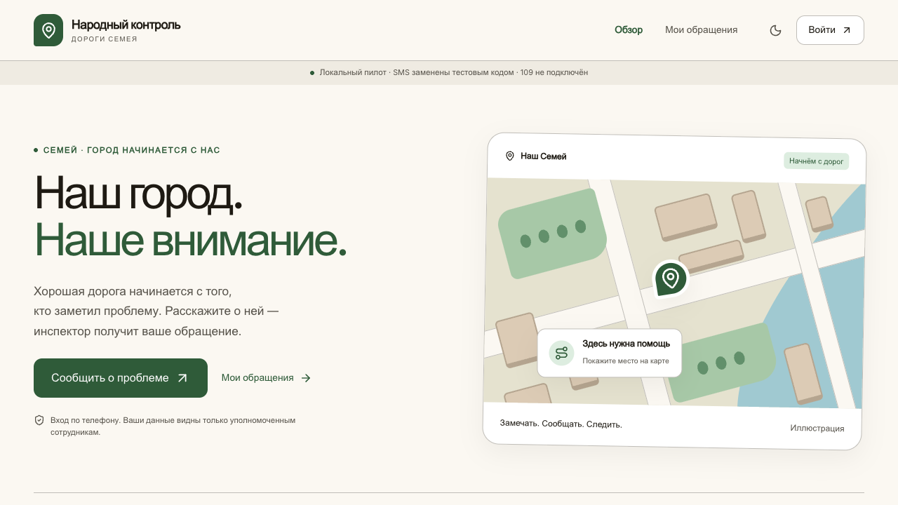
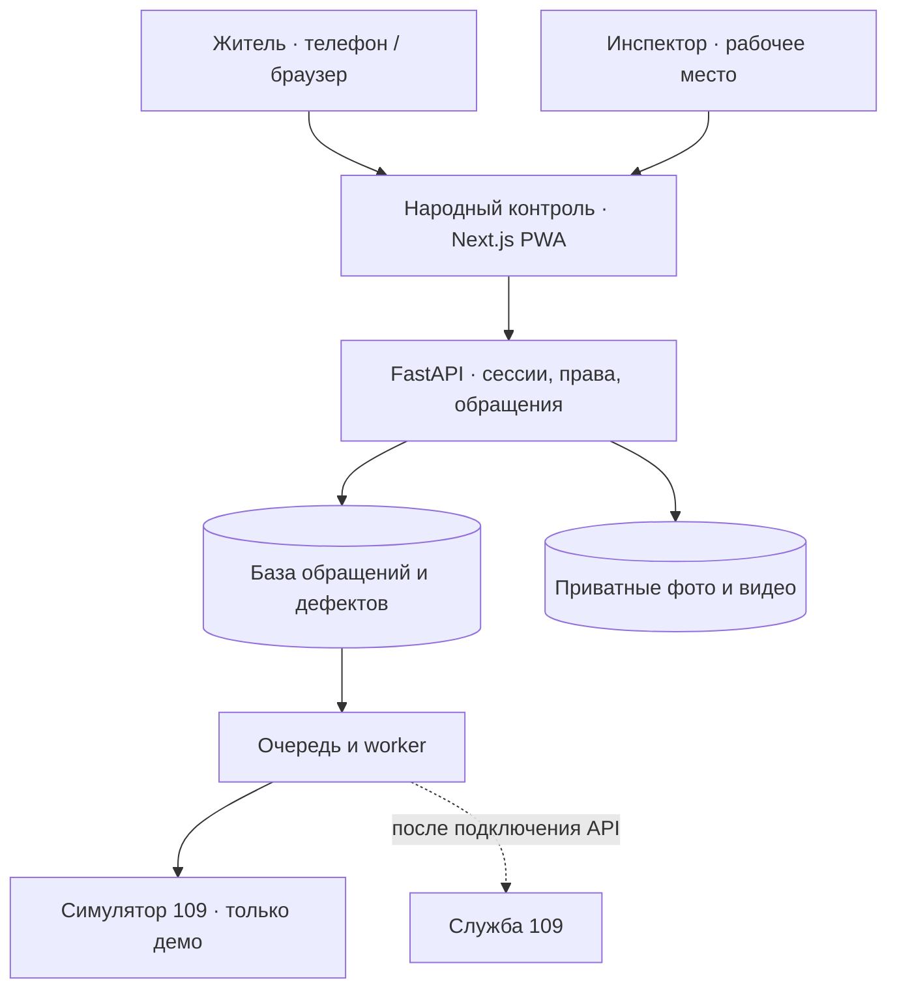

# Народный контроль — RoadScan

[](https://github.com/ernur077sss-art/RoadScan-AI/actions/workflows/ci.yml)
[](docs/PLAN.md)
[](#why-pwa)
[](#tech-stack)

> Городской сервис для жителей и инспекторов: сообщить о дорожном дефекте, приложить фото или видео, отметить место на карте и получить ответ в одном приложении.

[Сценарий демо](docs/DEMO.md) · [Документация](docs/) · [Архитектура](docs/ARCHITECTURE.md) · [План разработки](docs/PLAN.md) · [Быстрый запуск](#quick-start) · [Деплой на Vercel](docs/DEPLOY_VERCEL.md)

---



*Главный экран работающего MVP. Приложение адаптировано для телефона и компьютера.*

---

## О проекте

«Народный контроль» создаётся как конкурсный проект для дорожной обратной связи в Семее. Житель сообщает о проблеме, инспектор проверяет материалы и место, а сервис сохраняет результат рассмотрения. **RoadScan AI** — имя репозитория; автоматическое распознавание дефектов ИИ в текущий MVP не входит.

| Параметр | Описание |
|---|---|
| Город | Семей, Казахстан |
| Пользователи | Жители, инспекторы и администраторы |
| Текущая стадия | Работающий локальный MVP |
| Целевой KPI | Не менее **90% уникальных подтверждённых дефектов** с проверенной геопривязкой |
| Владелец репозитория | [@ernur077sss-art](https://github.com/ernur077sss-art) |
| Обратная связь по проекту | [GitHub Issues](https://github.com/ernur077sss-art/RoadScan-AI/issues) |

**90% — цель будущего пилота, а не достигнутый городской показатель.** Публичный приём обращений ещё не открыт; реальные SMS и 109 не подключены.

---

## Проблема и решение

### 1. Дефекты выявляются поздно и вручную

- **Проблема:** дорожная проблема может оставаться незамеченной до очередного осмотра.
- **Решение:** житель отправляет фото или короткое видео прямо с телефона; обращение поступает в рабочую очередь инспектора.

### 2. Место проблемы сложно найти по описанию

- **Проблема:** адрес или ориентир не всегда позволяют точно определить участок дороги.
- **Решение:** точка на карте, геопозиция телефона и ручной ввод координат. Инспектор отдельно проверяет место дефекта; отсутствие точки не препятствует отправке обращения.

### 3. Повторные сообщения искажают учёт

- **Проблема:** несколько жителей могут сообщить об одной яме, увеличивая число записей о ней.
- **Решение:** обращения сохраняются отдельно, а инспектор связывает их с одним дефектом после сравнения материалов. KPI считается по уникальным дефектам.

### 4. Житель не видит результат рассмотрения

- **Проблема:** после отправки сообщения непонятно, что произошло дальше и нужны ли дополнительные сведения.
- **Решение:** личный кабинет со статусом, ответом инспектора, запросами уточнений и историей. Подтверждение дефекта не означает выполненный ремонт.

---

<a id="why-pwa"></a>

## Почему PWA

- **Доступ по ссылке** — можно начать пользоваться сервисом в браузере телефона.
- **Установка на главный экран** — предусмотрены manifest, иконки и подсказки установки.
- **Один сервис для двух ролей** — жителю удобно отправлять материалы с телефона, инспектору — работать с очередью на компьютере.
- **Сохранение черновика** — текст, точка и вложения остаются в браузере на устройстве до отправки.
- **Общая кодовая база** — интерфейс жителей и рабочее место инспектора развиваются вместе.

Установка и съёмка на физических iPhone/Android ещё требуют проверки. При отсутствии сети доступна офлайн-страница; закрытое приложение не отправляет обращения в фоне.

---

## Возможности MVP

- Вход по телефону без ИИН; в локальном режиме используется тестовый код.
- Фото и видео до 30 секунд: до четырёх файлов, до 25 MB каждый.
- Карта, GPS, ручные координаты и адресный ориентир.
- Восстановление черновика и повтор отправки без создания дубля.
- Приватные обращения и вложения с проверкой прав на сервере.
- Очередь инспектора с поиском, фильтрами, картой и историей решений.
- Уточнение, подтверждение, отказ с причиной и связь нескольких обращений с одним дефектом.
- Расчёт KPI по проверенной геопривязке, включая в знаменатель дефекты без точки.
- Светлая и тёмная темы: «Зелёный квартал», Inter + JetBrains Mono, ровные цвета.
- Подготовленная очередь для будущего подключения 109; демонстрационный режим обозначен как симулятор.

---

<a id="tech-stack"></a>

## Технологический стек

| Слой | Технологии |
|---|---|
| Веб-приложение | Next.js · React · TypeScript · Tailwind CSS |
| Мобильные возможности | PWA · Service Worker · IndexedDB |
| Карта | Leaflet · OpenStreetMap |
| API и бизнес-логика | Python · FastAPI · SQLAlchemy |
| База данных | SQLite для локального запуска; PostgreSQL + PostGIS для целевого контура |
| Миграции | Alembic |
| Приватные медиа | Локальное файловое хранилище; подготовленный S3-адаптер |
| Обработка материалов | Pillow · FFmpeg |
| Проверки | pytest · Playwright · TypeScript |
| Инфраструктура | Docker Compose · GitHub Actions |

PostgreSQL/PostGIS и S3 требуют отдельной проверки в целевом контуре. Условия подключения — в [регламенте эксплуатации](docs/OPERATIONS.md).

---

## Архитектура



**Обращение** хранит сообщение конкретного жителя. **Дефект** объединяет подтверждённые сообщения об одном объекте. Исправление места и решения инспектора сохраняются в истории.

Полная схема, модель данных, формула KPI и работа с повторами — в [описании архитектуры](docs/ARCHITECTURE.md).

---

<a id="quick-start"></a>

## Быстрый запуск

**Требования:** Python 3.12, Node.js 24, pnpm 11.25.0. Команды ниже рассчитаны на macOS/Linux.

```bash
# Клонировать проект
git clone https://github.com/ernur077sss-art/RoadScan-AI.git
cd RoadScan-AI

# Установить зависимости
python3 -m venv .venv
.venv/bin/python -m pip install -r requirements.lock
pnpm --dir web install --frozen-lockfile

# Создать локальную базу и запустить API
.venv/bin/python -m alembic upgrade head
.venv/bin/python -m uvicorn api.main:app --host 127.0.0.1 --port 8000 --no-access-log --no-proxy-headers
```

Во втором терминале, из корня проекта:

```bash
pnpm --dir web dev
```

Откройте [localhost:3000](http://localhost:3000). Используйте синтетический номер, например `+77010000001`: локальный код появится в форме, реальная SMS не отправляется. База и вложения сохраняются в `.data/` и исключены из Git.

Для роли инспектора сначала зарегистрируйте второй тестовый номер, затем выполните на сервере:

```bash
.venv/bin/python -m api.manage grant-role --phone +77010000002 --role inspector
```

После обновления страницы появится раздел «Инспектор». Роль не выбирается при регистрации.

Подробности: [переменные окружения, production-сборка, Docker и резервные копии](docs/DEVELOPMENT.md). Локальный режим с тестовым OTP не предназначен для публикации в интернет.

---

## Проверки

```bash
.venv/bin/python -m pytest -q
.venv/bin/python -m scripts.check_brand
pnpm --dir web typecheck
pnpm --dir web build
pnpm --dir web test:e2e
```

**Зафиксированный локальный результат на 11 октября 2026:** 28 серверных тестов и 2 сквозных браузерных сценария прошли, production-сборка готова. Один тест PostGIS пропущен из-за отсутствия локальной базы. Интерфейс проверен на ширинах 375, 768 и 1280 px.

Сценарии, ограничения и подготовка браузера — в [отчёте о проверках](docs/VERIFICATION.md) и [инструкции разработчика](docs/DEVELOPMENT.md). Текущий статус CI показывает бейдж в начале README.

---

## Roadmap

- [x] **Этап 1:** требования, роли, экраны и фирменное оформление.
- [x] **Этап 2:** локальная основа приложения, миграции и конфигурация инфраструктуры.
- [x] **Этап 3:** OTP, сессии и права; локальный сценарий без реальной SMS.
- [x] **Этап 4:** обращения, фото/видео, карта, черновики и защита от дублей отправки.
- [x] **Этап 5:** очередь инспектора, уточнения, решения и учёт повторных сообщений.
- [x] **Этап 6:** KPI, мобильный интерфейс и основа PWA.
- [x] **Этап 7:** очередь, worker и симулятор передачи в 109.
- [x] **Этапы 8–9:** локальные проверки, восстановление резервной копии и сценарий конкурсного демо.
- [ ] Подключить реального SMS-провайдера.
- [ ] Проверить PostgreSQL/PostGIS, S3 и восстановление в целевом контуре.
- [ ] Подключить официальный API 109 и проверить квитанции приёма.
- [ ] Подготовить HTTPS-стенд и правила обработки данных реального оператора.
- [ ] Провести нагрузочные испытания и пилот с жителями и инспектором на физических телефонах.

Отметки относятся к перечисленным локальным результатам. Полные критерии и незавершённые части каждого этапа — в [утверждённом плане разработки](docs/PLAN.md).

---

## Материалы проекта

- [Деплой на Vercel: настройки веба, API и окружений](docs/DEPLOY_VERCEL.md)
- [Спецификация продукта и сценарии](docs/SPEC.md)
- [Архитектура и модель данных](docs/ARCHITECTURE.md)
- [Сценарий конкурсной демонстрации](docs/DEMO.md)
- [План разработки и текущие статусы](docs/PLAN.md)
- [Инструкция разработчика](docs/DEVELOPMENT.md)
- [Результаты проверок](docs/VERIFICATION.md)
- [Контракты SMS и будущей интеграции 109](docs/INTEGRATIONS.md)
- [Эксплуатация и подготовка пилота](docs/OPERATIONS.md)
- [Фирменное оформление](brand.md)

---

## Лицензия

Лицензия проекта пока не определена. Сведения о лицензиях используемых шрифтов сохранены в [font-licenses.txt](web/public/font-licenses.txt).
