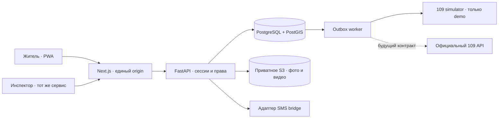

# Этапы 1–2: архитектура

## Слои приложения

Локальный профиль заменяет PostgreSQL и S3 на SQLite и приватную папку. Клиент взаимодействует только с `/api` своего origin. API повторно проверяет права на каждом запросе; скрытая кнопка не является защитой. Сессия хранится в HttpOnly cookie, в production также Secure; токен в базе хешируется. Телефон шифруется, поиск номера выполняется по HMAC. ИИН не хранится.

Карта загружается отдельно от формы. OSM используется как онлайн-подложка с атрибуцией; при недоступности карты сохраняется ввод адреса и координат. Шрифты локальные. Публичного реестра частных материалов нет.

## Наблюдение, дефект, работа

- **Observation / обращение** — исходный материал конкретного жителя, время поступления, место, ответ, история решений. Каждое обращение сохраняется отдельно.
- **Incident / дефект** — уникальный объект после проверки инспектора. Несколько обращений могут ссылаться на него. Его проверенная точка отличается от исходной точки жителя; исправление не переписывает исходные координаты обращения.
- **Work order / работа** — будущая задача исполнителю и доказательства ремонта. В MVP не реализована. «Подтверждено» не означает «Устранено».

Инспектор объединяет сообщения вручную после сравнения места, описания и медиа. PostgreSQL умеет предложить объекты в радиусе через `ST_DWithin`; радиус не является критерием автоматического объединения. В интерфейсе доступен список последних 100 объектов категории и материалы выбранного объекта. Полнотекстовый реестр всех объектов и поиск больших объёмов — развитие после пилота.

## Путь обращения

`Телефон → OTP → черновик в IndexedDB → приватная загрузка → обращение → проверка → решение → кабинет жителя`.

Статусы: `pending`, `needs_info`, `confirmed`, `rejected`. Уточнение возвращает запись на проверку. Все изменения версии проверяются сервером: устаревшее решение получает 409. Назначение ролей — CLI оператора или API администратора.

Вложения декодируются на сервере: EXIF удаляется; видео перекодируется в MP4 без аудио и метаданных. Ограничения: до четырёх вложений, 25 MB каждое, видео до 30 секунд; JPEG/PNG/WebP и MP4/MOV/WebM. HEIC пока требует преобразования. Обработка видео синхронная; масштабирование требует отдельного изолированного worker и нагрузочных измерений.

## Повторы, конкуренция и приватность

`event_id` уникален в пределах автора, `upload_key` — в пределах владельца файла. Повтор тех же данных возвращает тот же результат. Повтор ключа с другим содержимым отклоняется. Клиент сохраняет неизменяемое тело начатой отправки, пока не получит результат. Черновик привязан к аккаунту и устройству.

Для PostgreSQL используются транзакционные advisory locks и блокировки строк; SQLite сериализует изменения через `BEGIN IMMEDIATE`. Решения инспекторов пока сериализуются общей блокировкой; это осознанное ограничение небольшого пилота. Время поступления не меняется при повторе или уточнении.

Медиа выдаются через авторизованный API, включая запросы Range для видео. Сервис-воркер кэширует только общедоступную страницу отсутствия связи: cookie, OTP, API и частные материалы не кэшируются. После закрытия приложения фоновой отправки нет.

## KPI

`100 × активные подтверждённые дефекты с проверенной точкой / все активные подтверждённые дефекты`.

Знаменатель включает дефекты без координат. Связанные повторные обращения не увеличивают его. Период ограничивает дату создания уникального дефекта; верхняя дата исключающая, пользовательский ввод трактуется в часовом поясе Казахстана. При пустом знаменателе показывается «Нет данных». 90% — цель, не результат испытаний.

## 109

Транзакционная outbox-запись создаётся вместе с подтверждением, одна на дефект. Worker умеет демонстрационную квитанцию, повтор с задержкой и остановку после пяти неудач. Состояние `simulated` принципиально отличается от принятой реальной заявки. Адаптер официального 109 будет реализован по выданному контракту: ключ идемпотентности, квитанция, сверка неизвестного результата, статусы и журнал ошибок.

## Эксплуатация

Начальная миграция Alembic создаёт схему и PostGIS geography с GiST-индексом. Версии зависимостей закреплены lock-файлами. CI содержит серверные тесты на PostGIS, сборку и Playwright. Перед реальной эксплуатацией нужны выполненный CI, внешняя инфраструктура, резервирование, проверка на физических устройствах и политика данных оператора.
