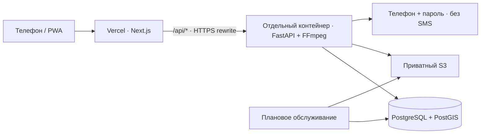

# Деплой «Народного контроля» на Vercel

Подготовка относится к **этапу 2 — инфраструктура** и **этапу 8 — HTTPS-стенд и пилот** [плана](PLAN.md). Конфигурация подготовлена, в Vercel создан проект `roadscan-ai`. Публичный деплой ещё не выполнен: облачный API и хранилища не подключены.

**Обязательное условие пользователя — только бесплатно.** Выбраны Vercel Hobby, Render Free и Supabase Free. Пошаговая настройка и ограничения: [DEPLOY_FREE](DEPLOY_FREE.md).

## Схема текущей версии



На Vercel импортируется **папка `web`**, API запускается из корня репозитория через `Dockerfile.api` на контейнерном хостинге. База и медиа находятся во внешних постоянных хранилищах. SQLite и локальное хранение медиа в production запрещены приложением.

Vercel поддерживает FastAPI, однако наш загрузчик передаёт файлы до 25 MB через API и синхронно обрабатывает видео. У Vercel Functions лимит тела запроса 4.5 MB. Поэтому используем **external rewrite прямо к контейнеру**, без промежуточного Next.js Route Handler / Function для медиа. Полный перенос API на Functions потребует прямых загрузок в хранилище и фоновой обработки. [FastAPI на Vercel](https://vercel.com/docs/frameworks/backend/fastapi), [лимит Functions](https://vercel.com/docs/errors/function_payload_too_large).

Браузер обращается к `/api/...` на домене приложения, включая чтение медиа. HttpOnly-cookie остаётся cookie этого домена; CORS и `NEXT_PUBLIC_API_URL` не требуются. CDN-кэширование API запрещено. [External rewrites](https://vercel.com/docs/routing/rewrites).

## 1. Подготовить API и постоянные данные

Нужны HTTPS-адрес контейнера, PostgreSQL с расширением PostGIS, private S3 bucket и вход по телефону и паролю (`ROADSCAN_AUTH_MODE=password`). Размещение согласуется по [условиям пилота](OPERATIONS.md).

Шаблон переменных — [`deploy/.env.example`](../deploy/.env.example). Для операторских команд скопируйте его в `deploy/.env` и заполните; настоящий файл игнорируется Git. На хостинге задавайте значения через его хранилище секретов.

| Переменная API | Значение / назначение |
|---|---|
| `ROADSCAN_ENV` | `production` |
| `ROADSCAN_ORIGIN` | Точный адрес веба, например `https://your-project.vercel.app`, **без `/` в конце** |
| `ROADSCAN_DATABASE_URL` | `postgresql+psycopg://…` с TLS по требованиям провайдера; пароль URL-encoded |
| `ROADSCAN_SECRET` | Уникальный случайный секрет от 32 символов, одинаковый для всех реплик и обслуживания |
| `ROADSCAN_STORAGE` | `s3` |
| `ROADSCAN_S3_ENDPOINT` | HTTPS endpoint S3; для AWS S3 можно оставить пустым |
| `ROADSCAN_S3_BUCKET` | Имя закрытого bucket |
| `AWS_DEFAULT_REGION` | Регион S3 |
| `AWS_ACCESS_KEY_ID`, `AWS_SECRET_ACCESS_KEY` | Ограниченные учётные данные S3, если платформа не предоставляет workload role |
| `ROADSCAN_AUTH_MODE` | `password`: бесплатный вход без SMS |
| `ROADSCAN_MIGRATE_ON_START` | `1` в Render Free; иначе отдельный шаг миграции |
| `ROADSCAN_109_MODE` | `disabled` до отдельного подключения 109 |
| `PORT` | Порт, выданный хостингом; по умолчанию `8000` |

Сохраняйте `ROADSCAN_SECRET` между релизами: он нужен для расшифровки телефонов. Публичный API запускается в `production`; OTP-эндпоинты при входе по паролю отключены.

Сборка из корня репозитория:

```bash
docker build -f Dockerfile.api -t roadscan-api .
```

**Один раз на релиз**, отдельным заданием с тем же образом и окружением выполните миграции **до старта новых реплик**:

```bash
docker run --rm --env-file deploy/.env roadscan-api python -m api.migrate
```

Операторский запуск на своём сервере (при `PORT=8000`):

```bash
docker run --rm --env-file deploy/.env -p 127.0.0.1:8000:8000 roadscan-api
```

Эта команда сама не создаёт HTTPS. На платформе используйте её ingress и выделенный `PORT`; на своём сервере поставьте HTTPS reverse proxy перед закрытым портом. Разрешите доступ из API к Postgres/S3. Роль миграций должна иметь право создать PostGIS либо расширение устанавливает администратор БД.

По умолчанию production использует отдельный шаг миграции. В Render Free нет бесплатного pre-deploy job: [render.yaml](../render.yaml) задаёт `ROADSCAN_MIGRATE_ON_START=1`. Миграции выполняются до запуска API под PostgreSQL session advisory lock, чтобы одновременные старты не применяли их параллельно. Нужен session pooler, не transaction pooler. `GET /api/health` проверяет БД и режим; S3 проверяется загрузкой и чтением файла.

Обслуживание: плановое задание из того же образа с командой `python -m api.worker --cleanup`. Постоянный worker 109 при `disabled` не нужен; реальная отправка остаётся отдельным этапом 7.

## 2. Импортировать веб-приложение в Vercel

В **Add New → Project** выбрать `ernur077sss-art/RoadScan-AI`:

| Настройка | Значение |
|---|---|
| Production Branch | `main` |
| Root Directory | **`web`** |
| Framework Preset | `Next.js` |
| Node.js Version | `24.x` |
| Install / Build Command | Из `web/vercel.json`; не переопределять в Dashboard |
| Output Directory | Стандартное значение Next.js, без ручного override |

[`web/vercel.json`](../web/vercel.json) устанавливает pnpm `11.25.0`, использует `--frozen-lockfile`, запускает проверки конфигурации, TypeScript и сборку. Node и pnpm также закреплены в `package.json`. Установка pnpm задана явно; отдельное включение Corepack не требуется. [Версии Node.js](https://vercel.com/docs/functions/runtimes/node-js/node-js-versions), [менеджеры пакетов](https://vercel.com/docs/package-managers).

Добавить в Vercel Environment Variables:

| Переменная веба | Значение |
|---|---|
| `API_INTERNAL_URL` | **Реальный HTTPS origin Python API**; без `/api`, логина, пароля и query string |

Название историческое: на Vercel адрес должен быть доступен платформе по сети. `localhost`, Docker-имя `api`, IP-адреса и демонстрационные `example.*` сборка отклоняет. Домен самого фронтенда создаст цикл проксирования. API должен отвечать по `/api/health` без редиректа на другой домен.

**База, S3 и `ROADSCAN_SECRET` настраиваются у API, не в Vercel.** Адрес API записывается в маршруты при сборке: после изменения нужен Redeploy. Vercel использует свой Next.js adapter; standalone сохраняется для локального запуска и Docker.

## 3. Связать домен и окружение

1. Определить постоянный адрес фронтенда — основной `*.vercel.app` или собственный домен.
2. Установить этот origin в `ROADSCAN_ORIGIN` у API и перезапустить API. Он проверяется для защиты изменяющих запросов.
3. Задать `API_INTERNAL_URL` в нужном scope Vercel и выполнить деплой.
4. Открывать именно этот адрес: случайный deployment URL и другой алиас **не равны** разрешённому origin.

Для Preview нужен отдельный API и отдельные тестовые данные, свой `API_INTERNAL_URL` в scope Preview и точный preview origin у API. Удобнее закрепить адрес тестовой ветки. Не разрешайте wildcard `*.vercel.app` и не направляйте PR-preview в рабочую базу. Публичный тестовый API также запускается в production-режиме со входом по паролю.

Git-интеграция Vercel может публиковать `main` независимо от GitHub Actions. Перед реальными данными настройте обязательные проверки релиза: один файл CI сам по себе публикацию не блокирует. [Deployment checks](https://vercel.com/docs/deployment-checks).

## 4. Проверить опубликованный стенд

Подставьте действительный домен вместо `YOUR-WEB-HOST`:

```bash
curl --fail --silent --show-error https://YOUR-WEB-HOST/api/health
curl --silent --show-error --include https://YOUR-WEB-HOST/api/auth/me
```

Первый запрос должен вернуть `status=ok`, `environment=production`, `database=postgresql`, `auth_mode=password`, `sms=disabled`, `integration_109=disabled`. Второй без входа — **401**, `Cache-Control: no-store` (допустимо с `private`), без HTML, редиректа или кэшированных данных.

На тестовом аккаунте:

- Зарегистрироваться по телефону и паролю, выйти и войти повторно; OTP-эндпоинты возвращают 404, cookie имеет `Secure` и `HttpOnly`, вход сохраняется после обновления страницы.
- Отправить фото, видео **больше 4.5 MB** и файл около допустимых 25 MB. Проверить создание единственного обращения, просмотр и перемотку видео, отказ при превышении лимита.
- Выдать роль инспектора через `python -m api.manage grant-role` в окружении API; пройти уточнение и подтверждение, сверить KPI.
- Другим аккаунтом проверить запрет доступа к чужим материалам и кабинету инспектора.
- Перезапустить контейнер и проверить сохранность обращений и медиа.
- Проверить PWA на Android/iOS, камеру/GPS и плохую связь.

У внешних rewrites таймаут **120 секунд**; `maxDuration` Next.js его не увеличивает. Полный путь загрузки и обработки видео нужно измерить на настоящем стенде. На ingress API выставьте лимит тела минимум **26 MiB**, согласуйте таймауты; FFmpeg сейчас ограничивает обработку 90 сек. [Таймаут прокси](https://vercel.com/docs/limits#proxied-request-timeout).

Uvicorn не доверяет пересылаемым IP-заголовкам. За прокси пользователи могут попасть в общий лимит входа (30 попыток за 15 минут и 10 регистраций в час); на номер разрешены 5 попыток за 15 минут. Перед пилотом настройте rate limiting на доверенном ingress и передачу клиентского IP только от проверенного прокси. Не доверяйте произвольному `X-Forwarded-For` и не отключайте ограничения авторизации. Доверенные адреса зависят от выбранного хостинга.

## Что осталось до приёма реальных обращений

- Создать API-хостинг, PostgreSQL/PostGIS, S3, заполнить секреты, выполнить миграции.
- Опубликовать Vercel-проект и связать его origin с API.
- Заполнить `/privacy` сведениями реального оператора, согласовать хранение и удаление по [условиям пилота](OPERATIONS.md).
- Пройти проверки выше, восстановление Postgres/S3, нагрузочный тест и тест на физических телефонах.

Подготовленная сборка не означает, что внешние проверки уже пройдены. ИИ и реальная отправка в 109 этим деплоем не добавляются.
